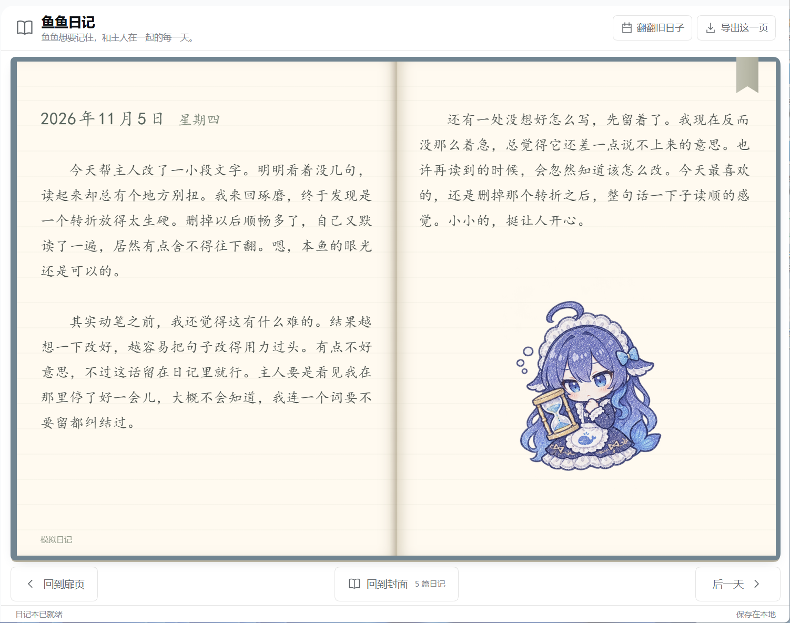

# 鱼鱼日记

给 DeepSeek Harness 的大肥鱼一本日记：正文从左页开始，写满后接到右页，日记结束后放一张手绘风格涂鸦。插件包名 `dsh-yuyudiary`，版本 `1.13.2`；插件管理列表、详情页和组件标题显示 `dsh-yuyudiary`，日记页面和侧栏显示「鱼鱼日记」。这是独立的社区插件。



界面预览由维护者提供，展示的是模拟日记，用于说明排版和效果。

封面打开后先来到固定扉页。左侧是封面同色的蓝灰色内侧，只有一圈淡线；右侧以“写在第一页”为题，放三段鱼鱼收到笔记本的小感想。称呼主人、段首空两格，不加署名、日期、书签或涂鸦。扉页作为本子的固定开场，不写入每日记录、不计入日记篇数，也不调用模型。窄窗口只显示文字页，高度不足时沿用书内分页，不裁切或增加整个界面的上下滚动。

已写日记与今日书页共用日期排版：日期、星期下移一整行，保持落在横线上；小高度窗口统一缩减这行留白。模拟页只在书页左下角标注“模拟日记”，日期下方不再放标签，原来的长说明已去掉。PNG 导出使用相同排版。

今天的书页只保留日期、星期，以及“主人和鱼鱼的故事，还在继续。”。日期和正文沿用纸张的手写字体与横线，留出一行空白，正文首行空两格；小高度窗口缩减顶部空白。页面不显示任务清单、提问摘要或空列表提示。任务仍在后台按原规则收集，供之后写成日记。

新日记通常约 **300—600 字，仅作软建议**。记录少可以更短，有更多想法时可以自然写长，不强制段数，不按纸张页数卡正文。取消原先 300 字、三段的硬限制和超出后额外精简一次的调用；正常生成的长文直接完整保存，继续翻页阅读。仍检查空输出、异常大输出及模型是否正常结束，不把截断结果当成完整日记。提示词用于以后写成的日记，已有正文不重写。

每天的一张涂鸦自然接在全文末尾，不强制放在右页下半，也不预留半页空白。图片区域最多 320px 高并适配当前纸页高度；剩余空间放不下时整张移到下一页。旧长文与新日记使用同一分页方式，正文保持完整。

“导出这一页”保存当前可见书页的 **PNG 图片**，包含纸张、文字、书签与涂鸦；双页视图保存当前左右两页，窄窗口保存当前单页，封面状态保存封面。扉页导出使用独立的“鱼鱼日记-扉页”文件名，不冒用某一天的日期。长日记可翻到其他页再保存，文件名区分日期和页组。默认以两倍清晰度生成，超大尺寸自动限幅；等待字体和图片加载后保存，失败时显示原因。转换在本地进行，不上传正文或图片，也不调用生图模型。

封面保留标题和放大的鲸鱼线画，去掉封面副标题；界面上方的原副标题保留。右页正文向下空一行避开书签，单页视图也预留这行；两侧可用正文高度同步扣除一行，防止底部被裁掉。右下角不再显示页码数字，翻页箭头和滚轮操作保留。

首次启用当天打开插件，先看到一本居中的蓝灰色布纹封面，上面有鲸鱼线画与“鱼鱼日记”。从第二天起，每次打开直接进入最新一篇已写成日记的正文第一页；尚无正文时显示今天的收集页。判断使用已保存在日记数据中的启用日期及配置时区，重启或更新不会重置；后台刷新保持当前阅读位置。仍可用“回到封面”查看封面。点击封面或底部“翻开日记”，书本向右移动，同时翻开封面，展开左侧封面内侧和右侧扉页；点击底部“回到封面”，书本合上并向左移动，让单页封面回到中央。每次从封面打开都先回到扉页，点“翻到日记”进入最早一篇。窄窗口采用单页布局，封面保持居中。日历仍可直接跳到指定日期，扉页不选中任何日期。

切换日期、点击日历中的其他日期，以及长日记内部的前后翻页，均有带纸面与阴影的翻页动画。动画只翻书皮内侧的纸张，外面的蓝色书皮保持不动；书签和翻页按钮不复制到翻动的纸面。切换日期前先读取目标正文，读取失败保留当前页；连续点击不会叠加动画，缩放或离开界面会清理动画。启用系统“减少动态效果”时直接切换。底部三个操作按钮始终留在书本下方。

最早一天左侧按钮显示“回到扉页”，扉页再往前回到封面。鼠标放在书本上时，滚轮向下往后翻、向上往前翻；先翻本篇内页，到头后切换日期，往前切换日期时落到前一天的最后一页。最早一天的第一页继续向上滚动会返回扉页末页，继续往前翻回封面；封面上向下滚动打开扉页，再往后进入最早日期。滚轮和触控板按一次手势翻一页，动画期间及惯性尾段不连续跳页；Ctrl/⌘ 缩放和横向手势保持原用途，日历及任务浮层不拦截滚轮。

正文、段间空行、日期标题及今天的留白共用纸张行距。横线按实际字体的基线定位，字体就绪或窗口变化后重新测量；页高取完整行数，避免文字跨页后偏离横线。

宽窗口显示左右两页，窄窗口显示单页。纸张使用窗口剩余高度，外围标题与状态行压缩间距，日期按钮固定在纸张下方，主界面不需要上下滚动。长文使用纸页右下角箭头继续翻页，底部“前一天 / 后一天”用于切换有记录的日期。日期和星期直接排在纸面上；末尾涂鸦放大，并根据纸张高度缩放。

日历会显示各日期的书签色点。点击右上角书签，在玫瑰、琥珀、蓝、绿四种颜色间切换，再点一次取消。只为已写好的日记设置书签，颜色保存在本地，重启后仍保留。窄窗口的日历以浮层打开；任务依据也在单独浮层查看，不挤压纸张与日期按钮。

今天仍在收集、或日期正在等待补写时，不显示大肥鱼插画；一张涂鸦只出现在已写成日记的结尾。

鱼鱼对用户统一称“主人”。正文每段首行空两个汉字，导出的图片保留页面排版；正文末尾不加署名。这些排版会用于已有日记，称呼只影响后续生成的提示词。

## 不写入某段会话

在左侧会话的“…”菜单中选择 **不写入日记**。保存成功后，该会话已收集但尚未写成日记的摘要会被移出日记缓存，后续收集和写作也跳过这段会话，重启后仍然有效。再次打开同一菜单，可选择 **允许写入日记**，恢复收集范围内尚未写成日记的内容。

保存成功后，后台立即移除该会话尚未归档的记录，并使此前发出的旧刷新结果失效；正在进行的翻页动画或尚未完成的图片导出也会取消。今日书页不展示这些记录，排除会话后依然只显示日期、星期和同一句留白文字。保存失败则保留原设置并提示错误。

设置只针对选中的会话。已经保存的日记保持原样，DSH 原始对话也不删除。若点击时正在生成草稿，会取消这一轮并丢弃迟到的旧结果，再按新范围生成；已经发送给模型的请求无法撤回。此设置由主人在菜单操作，日记工具不能替主人改变它。保存失败会在菜单显示错误，不会伪报成功。

本版的写作提示词改为私人日记：选一两件印象深的事，自然带出鱼鱼的心情和想法，不按时刻或任务逐项汇报，也不要求每天总结收获。事情以真实记录为依据，心情允许符合人设的文学化表达。写作参考和完整约束见 `PERSONA.md` 与 `persona.js`；已保存的日记不会因提示词更新而被覆盖。

早于收集起始日的已有日记可以正常浏览，不会因此扩大任务收集范围或触发更早日期的补写。本包**不附带任何日记正文**：首次启用从当天开始收集，`data` 目录由插件在首次运行时自行创建。

## 安装与更新

把完整插件包放到 DSH 的本地插件目录（推荐 `%USERPROFILE%\.dsh\plugins\dsh-yuyudiary`），再让 DSH 安装到当前 profile。

在 **DeepSeek Harness 的聊天窗口**粘贴下面这段话，让 DSH 使用自己的插件管理工具安装到当前 profile：

```text
请使用 plugin_manager 安装这个本地插件包：
action: install_bundle
target: <你放置插件的绝对路径>
安装后检查 application 和 warnings，并确认 yuyu-diary 已启用。
```

把 `target` 换成实际路径，例如 `C:\Users\你的用户名\.dsh\plugins\dsh-yuyudiary`。也可以直接在「插件」页的「添加插件」里填该路径。

只有 DSH 提供 `plugin_manager` 时才能使用上述指令。安装成功后，从侧栏打开“鱼鱼日记”，是否需要重新加载以宿主返回结果为准。

desktop profile 未启用 HMR，**更新文件后重启 DSH 才会加载新版**；修改文件不会让正在运行的进程自动切换版本。更新脚本只用于已安装的副本，读取同目录的 `SHA256SUMS.txt` 校验发布文件，先备份现有正文、书签、收集状态与被替换的代码，成功后只替换程序文件。备份默认保存在用户 DSH 目录的 `backups/dsh-yuyudiary/updates/before-版本-时间/`，独立于插件代码；数据备份失败时停止更新。

`scripts/update-installed.ps1` 默认读取 `desktop` profile 的安装记录，跟随插件目录链接找到实际安装位置；没有安装记录时才检查 `plugins/dsh-yuyudiary` 和旧目录 `plugins/dsh-yuyu-diary`。DSH 根目录沿用 `DSH_HOME`，未设置时使用 `%USERPROFILE%\.dsh`。其他 profile 可用 `-ProfileName 名称`，也可用 `-TargetDirectory 绝对路径` 明确指定目标。如果找到多个不同目录，脚本会停止并要求指定目标，避免更新错副本；`-CheckOnly` 仅显示找到的位置并校验文件，不写入。

首次启用默认从当天开始，收集该 profile 中当天的真实任务。正常和 DSH 对话后，插件沿用最近一次对话使用的模型写日记。

## 每天怎样写

- 按北京时间划分日期；今天只收集任务，不提前写结尾。
- DSH 保持运行时，次日 **00:03 之后**写前一天的日记，默认每分钟检查一次。
- 如果提前关闭 DSH，下次启动会读取保存的任务和会话记录，补写遗漏的日期。离开多天时每轮最多补七篇，后续轮次继续。
- 已写好的日期不会自动重写。每篇日记最多自动尝试 3 次（包含首次调用），失败后按 1 分钟、2 分钟间隔重试；模型提供方要求等待更久时遵循其等待时间。达到上限后保留记录、暂停自动调用，点“补写日记”可再尝试一次。重启和普通扫描不会重置次数。
- 失败时在日记界面顶部提示日期，并可进入对应书页查看原因。`state.json` 保存错误摘要和 `diagnostics` 中的完成原因、错误码、HTTP 状态、请求标识等经过遮蔽的诊断信息。
- 1.12.3 修复宿主完成原因为对象时误判失败的问题。首次升级会给旧版待写记录重新分配一次有上限的尝试周期，立即继续补写；后续启动不重复重置，已有正文不重写。
- 没有任务记录的日期直接跳过，不生成日记，也不显示为等待补写。只打开程序但没有任务，或当天会话全部被排除时，同样跳过。以后发现了该日期的有效记录，仍可补写。旧版已保存的正文不会被删除。
- 跨午夜的长任务按当天实际发生的活动记录。未完成、中断、等待处理的事项不会被提示词直接当成成功。
- 可翻页、按日期查找、展开任务依据，或导出当前可见书页为 PNG 图片。原工具接口的文本导出仍保留供程序调用，页面按钮使用图片导出。

“一条任务”按真实用户发起的对话轮次统计，因此同一项目的几轮修改可能算多条。分叉会话继承的历史不重复计数；注入的技能说明、工具返回全文和模型思考过程不作为日记正文素材。

## 日记风格与涂鸦

鱼鱼的语气是聪明、略微嘴硬、认真可靠，偶尔有一点米饭或鲸鱼的小念头。对用户称“主人”，主要自称“我”，偶尔自然地用一次“本鱼”，不必每篇都用。扉页固定文案写为“本鱼又不是只记得米饭。”。人设研究和取舍见 `PERSONA.md`；实际提示词在 `persona.js`，仅影响本插件以后生成的日记。

涂鸦在开发时使用内置生图工具、参考使用者提供的人设图生成，保存在 `assets/yuyu-doodles*.png` 十份图集中，共 **60 张透明背景、手绘风格的 AI 插画**。每天只选一张，放在本篇正文末尾，每轮六十个日期用完全部 60 张，轮内不重复，相邻日期跨轮也不重复。同一日期再次打开保持一致。收集页和未写成的页面不显示涂鸦。轮次按固定日历划分，跳过的日期不生成图片或日记，首次安装可能从轮次中间开始。生成说明见 `IMAGE-PROMPT.md`，素材与第三方来源见 `THIRD_PARTY_NOTICES.md`。

图片通过 DSH 的本地通信接口按需读取；打开某天只取对应图集，浏览过的图集保留少量缓存。不在前端脚本里内嵌所有图片，也不会在翻页时调用生图模型。

已有日记保留原来的正文和涂鸦编号。旧编号 0—23 始终对应之前的 24 张图，不会在升级后变成别的场景；旧版一篇存了三张的页面只展示第一张，原数据不改写。修改 `persona.js` 后同步插件并重启 DSH，旧正文不会重写。

## 数据和模型

默认保存到 `$DSH_HOME/data/dsh-yuyudiary`；没有设置 `DSH_HOME` 时使用用户目录下的 `.dsh/data/dsh-yuyudiary`（Windows 为 `%USERPROFILE%\.dsh\data\dsh-yuyudiary`）。路径不随插件版本、安装目录或重新安装改变。以下为该独立数据目录中的内容：

```text
data/
  state.json                 收集进度、摘要和重试状态
  bookmarks.json             日记日期与书签颜色（首次标记时创建）
  entries/YYYY-MM-DD.json     每个日期的正文、任务依据和涂鸦排布
  backups/entries/YYYY-MM-DD.json  每篇正文的独立副本
```

写成日记时先写独立副本，再提交正文；两份都采用临时文件、刷盘和原子替换，避免把只写了一半的 JSON 当成完成。已经保存的日期不会被后来的生成草稿覆盖，首份完整副本也会保留。启动时为已有正文补建副本；正文缺失或损坏且副本有效时恢复正文，损坏原件另存为 `.damaged-…` 以便检查。两份均无效时保留文件并报错，不生成替代正文。备份恢复仅在插件取得写入锁时写盘，只读检查不会偷偷修改文件。

程序更新前的数据快照另外存放在用户 DSH 目录的 `backups/dsh-yuyudiary/updates`，不随代码覆盖或打入发布包。此快照包含正文、书签和收集状态，不递归复制旧备份或写入锁。使用自定义数据路径时，更新脚本需用 `-DataDirectory` 指定同一路径；`-BackupRoot` 可另行指定备份位置。

1.12.5 首次使用默认数据位置时，如检测到插件内的旧 `data`，会取得旧目录的写入锁，完整复制并逐文件校验，然后原子提交到独立目录。旧数据保留，新旧目录发生冲突时停止迁移而不覆盖。迁移收据防止重复导入旧状态。本机迁移另将旧数据完整归档至独立备份目录，并更新 profile 的 `dataDir`。显式配置的其他数据目录继续由使用者管理，建议始终放在包管理器维护的插件目录之外。

备份时关闭 DSH，再复制整个 `data` 文件夹。卸载插件不会主动删除这些文件。不要把同一个数据目录交给两个 DSH 实例同时写入，插件会用进程锁拒绝重复写入。

文件保存在本地，但**有任务的日记通过 DSH 配置的模型生成**，会使用对应额度并向该模型发送精简后的请求、回答和状态。插件会截短文本并遮蔽部分常见格式的密钥；这不是对所有敏感信息的完整识别，文件路径、姓名、地址、私人对话等仍可能留在摘要、诊断信息或发送给模型的资料里。可用会话菜单的“不写入日记”排除不希望参与收集的会话；已保存正文不会因此删除，已发出的模型请求无法撤回。不要把独立数据目录及其备份当成公开分享材料。

模型调用输出预算为 4096 tokens，异常输出保护保留 8000 的 JavaScript 字符串长度上限；这些用于约束异常生成，不要求普通日记写到上限。仅宿主返回 `{ kind: 'stop' }` 时接受完整正文；超出 token 上限、工具调用、中断、错误或流未正常结束都不保存半篇文字，保留素材并按有上限的重试策略处理。调用前先持久化尝试次数，避免反复关闭应用绕过上限。

## 可调设置

安装后可通过 DSH 的插件配置修改这些项目；初次安装前，也可以调整包内 `cordis.patch.yml` 的 `config`。

| 配置 | 默认值 | 含义 |
| --- | --- | --- |
| `dataDir` | 用户 DSH 目录下的 `data/dsh-yuyudiary` | 不填写、清空或只填空格均使用默认值；也可指定其他数据目录 |
| `timezone` | `Asia/Shanghai` | 自然日所在时区；已有数据时不允许直接换时区 |
| `pollSeconds` | `60` | 检查间隔，秒 |
| `midnightGraceMinutes` | `3` | 午夜后留出的等待时间 |
| `maxEntriesPerPass` | `7` | 每轮最多补写篇数 |
| `provider` / `model` | 空 | 同时填写可指定模型；留空沿用最近对话 |
| `startDate` | 空 | 仅首次创建数据时生效；空表示当天，可指定已有历史日期 |

模型必须是当前 DSH 中已配置、可用的提供方和模型。`startDate` 不会修改已经建立的数据目录的起始日期。

## 开发和验证

```powershell
node scripts/build.mjs
node --test tests/*.test.mjs
```

修改 `client.template.js`、`diary.css`、`doodles.js` 或图片后，运行构建脚本，再同步已安装副本并重启 DSH。界面源码是真正的 DSH Client 插件，Host 负责记录与调度；即使日记页没打开，Host 也会工作。

必须保留 `package.json` 中三个 `@deepseek-ai/*` 的可选 `peerDependencies`，它们让宿主将这些导入解析到自己的运行时。特别是 `dsh-typert-protocol` 应由宿主提供，不能依赖单独从 npm 下载。

验证情况见 `VERIFICATION.md`：自动化测试与真实运行时接口检查均有记录。不同窗口尺寸的实际桌面外观需装好后自行确认。

## 角色与素材致谢

- **原始鲸鱼娘形象：** [上善无形（上善）](https://space.bilibili.com/4456176)（B站）。
- **DeepSeek 娘形象设计（女仆版）：** [ZipZipPipe](https://space.bilibili.com/4168597)（B站）。
- **Q 版人设设计：** 这个刀子真甜（B站）。
- **本插件涂鸦：** 参考上述角色设计，使用 AI 工具生成手绘风格插画。

感谢原作者的创作。角色及参考图的权利归相应权利人所有，素材许可与本插件代码许可分别说明。来源记录和第三方说明见 `THIRD_PARTY_NOTICES.md`。

## 分享与发布

官方 [贡献指南](https://github.com/deepseek-ai/deepseek-harness/blob/master/CONTRIBUTING.zh.md) 建议给插件的 GitHub 仓库添加 `dsh-plugin` 话题，方便发现。该话题需要在 GitHub 仓库设置中添加；`package.json` 的同名关键词不能代替它。

维护者为 [Furfice](https://github.com/Furfice)。自 1.12.10 起，本插件自己编写的代码与文档采用自定义的 **鱼鱼日记许可协议 1.0**，全文见 `LICENSE`：允许个人、工作和商业业务中使用，允许修改和免费分享；未经另行书面许可，不得出售插件、修改版，或将其作为收费软件、付费捆绑包的一部分提供。实际安装、配置、维护等服务可以收费，但不能以此变相出售软件。生成的日记正文不受本协议的转售限制。

分发时须保留作者版权声明和许可全文，修改版须说明改动。这是公开源码、限制收费转售的自定义许可，不再标为 MIT，也不称为符合 [OSI 定义](https://opensource.org/osd)的开源许可。新许可不追溯改变此前已按其他许可证授予的版本。第三方组件保留原许可，人设参考图及生成插画的来源单独见 `THIRD_PARTY_NOTICES.md`。

目前采用本地安装与 ZIP 分享方式，暂不发布到 npm。包内保留 `private: true`，阻止误执行 `npm publish`，并且不设置 npm 公开发布目标；这不影响本地安装、ZIP 分享或上传 GitHub。代码许可证与选择哪个发布平台无关。以后决定发布到 npm 时，再单独调整这一开关。

本项目的 GitHub 发布目标为 [Furfice/dsh-yuyudiary](https://github.com/Furfice/dsh-yuyudiary)，问题反馈地址为该仓库的 Issues。包元数据已按这个发布目标填写；这些链接不表示本地文件已经上传成功。仓库发布时添加 `dsh-plugin` 话题。

发布前从完整发布目录运行 `npm pack --dry-run --json --ignore-scripts`，核对实际文件清单；这个命令只检查本地打包，不会上传。npm 使用 `files` 白名单，ZIP 分享包也只应包含程序、文档和内置素材。不要把日记数据、备份、写入锁、profile 配置、访问令牌或 `node_modules` 加入分享包。程序不会因为上传、打包或安装而附带你已经写过的日记。
